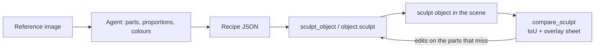
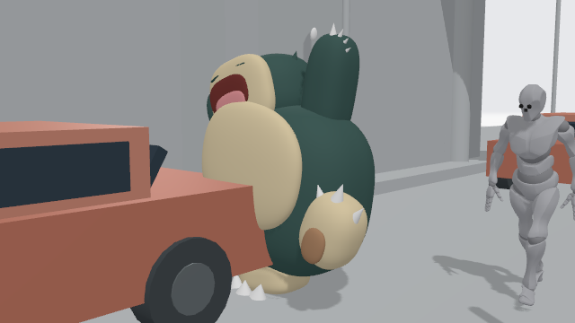

# Sculpt objects: a clay prop from one reference image

STATUS: implemented (#730); live QA: `mcp/qa-sculpt-live.mjs`

An agent looks at a reference image, breaks the subject into a handful of soft clay parts, and stands the result in the set as one object. The object is **data, not code**: a `sculpt` record carries a recipe of parts, and CozyClay builds the geometry from it. Nothing the agent writes is executed.

This is the previs-sized version of the img2threejs loop. Two runs (a chibi turtle in glasses and a sea-stack diorama) showed where the time goes: 70% of it went to camera fitting and to working around a code generator. A recipe that the editor renders directly removes both.



## Why a recipe and not a baked GLB

| | Bake a GLB, then `import_mesh` | `sculpt` recipe |
|---|---|---|
| Memory-only MCP | No: needs a live editor | Yes |
| Project export | Bytes live in IndexedDB and are lost | Inside the scene JSON |
| Agent edits | Rebake the whole model | Patch one part |
| Safety | File parsing | Plain data, validated |

## Recipe contract (v1)

```json
{
  "version": 1,
  "parts": [
    { "id": "head", "shape": "blob", "size": [1.5, 0.84, 1.1], "roundness": 0.6,
      "position": [0, 1.55, 0.03], "rotation": [0, 20, -6], "color": "#4a8e9c" },
    { "id": "eye", "shape": "blob", "size": [0.44, 0.36, 0.3], "parent": "head",
      "position": [0.38, 0.1, 0.48], "color": "#ece8ec", "mirror": true },
    { "id": "rim", "shape": "frame", "size": [0.76, 0.42, 0.07], "border": 0.09, "parent": "head",
      "position": [0.41, 0.1, 0.68], "color": "#240405", "mirror": true }
  ]
}
```

Units are metres, angles are degrees, the floor is `y = 0`, front is `+z`, and the subject's own left is `+x`.

| Field | Meaning |
|---|---|
| `id` | Unique part name, `a-z 0-9 -`. |
| `shape` | `blob`, `box`, `cylinder`, `torus` or `frame`. |
| `size` | Full extents `[x, y, z]`. A torus reads `[outer diameter, outer diameter, tube diameter]`. |
| `roundness` | `blob`: 0 is an ellipsoid and 1 is a rounded box. `box`: the edge bevel as a fraction of the smallest side. |
| `taper` | `blob`, `cylinder`: −1 to 1. Positive values narrow the top and negative values narrow the bottom. A cylinder with taper 1 is a cone. |
| `border` | `frame`: the rim width in metres. A frame is a rectangular ring, like a glasses rim, a window or a picture frame. |
| `position`, `rotation` | Measured in the parent's frame when `parent` is set, otherwise in the object's frame. |
| `parent` | Another part's id. The part rides that part's position and rotation. |
| `mirror` | `true` adds a reflected copy across `x = 0` of the parent frame. This is a reflection and never a rotation. |
| `color` | `#rrggbb` clay colour. |

Limits: at most 48 parts after mirroring, each extent between 0.005 and 20 m, and parent chains at most 8 deep. A recipe that breaks a limit is refused with the reason. It is never clamped into a different shape.

The record stores the normalized recipe, plus `footprint` and `height` measured from the parts' bounds, so the plan board, the drop logic and the selection cage work without building geometry.

## Editing and comparing

- **Patch, don't resend.** `sculpt_object { id, edits }` (Studio: `object.sculpt`) applies `{ set: partId, ...fields }`, `{ add: part }` and `{ remove: partId }` in order. `parent: null` and `mirror: false` clear those fields, and `remove` also takes the part's children. Changing `shape` drops the old shape's options. The patched recipe is validated as a whole, and the receipt names the parts that changed.
- **Compare against the reference.** `compare_sculpt { id, reference: "<png|jpg path>", yaw?, elevation? }` runs on this machine without an editor. It turns the reference's subject into a mask: alpha when the image has transparency, otherwise everything that differs from the border colour. It draws the sculpt's silhouette orthographically from the view, fits it to the subject's height, top and best horizontal offset, and returns:
  - `iou`, `missingFraction`, `extraFraction`
  - `widthToHeight` (reference vs sculpt)
  - `missingByBand` (top, middle, bottom thirds: where to add)
  - `extraByPart` (which parts stick out)
  - a sheet: the reference beside an overlay (grey = both, red = missing, blue = extra)

  Leaving out `yaw` tries −45° to 45° and keeps the best. Only shape is scored, not colour.
- **Try several fixes at once.** `compare_sculpt { id, reference, candidates: [{ label, edits }, …] }` scores up to 12 alternative edit sets from the same view in one call and applies none of them. It returns a ranking against the current sculpt (IoU, delta, bands, parts) and the winner's sheet. Apply the winner with `sculpt_object { id, edits }`. Each candidate costs about 0.1 s of local computation and no model turn, so in one round the agent can test one idea per mismatch instead of guessing which single fix is right.
- **One round, one call.** `sculpt_object { …, capture: true }` returns the editor frame with the receipt when an editor is connected.

## Agent workflow (image → sculpt)

1. **Measure the image before writing anything.** Find the subject's bounding box, then where each limb tip, the head top and the feet sit as fractions of its height, and convert those to metres. The best draft in the measurements below came from this step, not from iteration.
2. **Read the image for identity.** Name the subject, the parts and their contact relationships. List the 3–5 features that make the subject recognizable (for the turtle: oversized glasses, bulging eyes, the buck tooth, the belly plate). Say which sides the image hides.
3. **Block out from the measurements.** Put parts on the measured landmarks; a few small parts (claws, ears) are fine where the outline has them.
4. **Place it, then score.** Call `sculpt_object`, then `compare_sculpt` with the reference path. Read `missingByBand` and `extraByPart` before you look at the sheet.
5. **Patch, don't rewrite.** Write 3–6 candidate `edits` (one per mismatch you see), rank them with `compare_sculpt { candidates }`, and apply the winner. Fix the biggest mismatch first: proportion, then placement, then colour. Allow three rounds at most, or stop once IoU stops rising, then report what still differs.
6. **Identity details last.** Add eyes, rims and plates as small parts on a parent once the body reads.

Ask, infer and omit follow `agent-prompt-to-scene.md`. Infer the hidden back and say so. Never ask for more views unless the user wants a likeness.

## Measured: one loop vs parallel (Snorlax, 2026-10-11)

Same reference, a front view with both arms raised. Scores come from `compare_sculpt` at yaw 0 and were re-run independently afterward.

| Approach | Wall time | Best IoU | Notes |
|---|---|---|---|
| One agent, whole-recipe rounds (3 rounds) | 76 s | 0.761 | Guessed one fix per round; two rounds barely moved |
| One agent, `candidates` (3 rounds × 6 fixes) | 23 s | 0.793 | Same start; each round kept the best of six |
| Three agents in parallel, different decompositions (body-first / silhouette-trace / segmented) | 639 s (slowest agent) | **0.945** | Silhouette-trace won in its first draft (31 parts). All three stopped after round 1 and had to be resumed; after resuming, one rewrote a worse 10-part recipe and the best stayed round 1 |

What this says:

- **Measuring the reference beats iterating on a guess.** The 0.945 draft measured the outline in pixels (where each arm tip and foot sits) before writing parts. That one change was worth more than every later round in every run.
- **`candidates` is the cheap speed-up.** 6 fixes cost under 1 s, so a round never applies a fix that makes the sculpt worse.
- **Parallel decompositions buy quality, not speed.** About 3× the tokens and the slowest branch's wall time, for a better first draft. They are worth it for a hero prop and not for set dressing.
- **Stop when a round stops paying.** Candidate refinement on the 0.945 winner found nothing better (+0.000). Every agent's later rounds were flat or worse.



## Plan

| Step | Deliverable |
|---|---|
| 1 | `src/sculpt-recipe.js`: normalize, validate and measure bounds. Pure, with node tests. |
| 2 | `src/sculpt-geometry.js`: recipe to three.js Group (blob = superellipsoid radial remap). |
| 3 | `sculpt` kind: create, normalize, duplicate, serialize, render, hierarchy and inspector. |
| 4 | Studio action `object.sculpt` and MCP `sculpt_object`, in live and memory mode. |
| 5 | Agent rules (this page) in the MCP tool description and the Studio prompt. |
| 6 | QA: the turtle recipe through MCP into a live editor, with a screenshot in the PR. |
| 7 | Part-level `edits`, `compare_sculpt` (reference mask, silhouette IoU, overlay sheet), `capture: true`. |

Out of scope, for follow-ups: saving a sculpt to the asset shelf, per-part editing gizmos, and textures.
